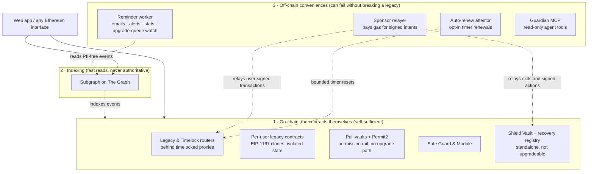

# Architecture

10102 Computing Legacy is deliberately layered so that the **on-chain layer is self-sufficient**, and the **off-chain layer is strictly additive**. If the off-chain services disappeared tomorrow, every existing legacy and timelock would still function: you'd lose email reminders and the pretty UI, and nothing you set up would change.

## The layers

### 1. On-chain: the contracts

Solidity contracts on Ethereum, verified on Etherscan and published at [github.com/10102-io/computing-sc](https://github.com/10102-io/computing-sc). Two kinds, and the difference matters:

- **Upgradeable proxies** (the routers, the Premium stack, the terms verifier, the three timelock vaults), administered by a `ProxyAdmin` that is owned by a public 48-hour upgrade timelock; see [Upgrade Policy](upgrade-policy.md).
- **Contracts that cannot be upgraded at all**: every per-user legacy contract, the pull vaults, the Shield Vaults, the recovery registry, the NFT collection list and the timelock itself. A fix there is a new deployment for new users; what exists keeps its code.

The parts:

- **Legacy routers**: `MultisigLegacyRouter` (Safe owners) and `TransferEOALegacyRouter` (plain EOAs). The router for Safe-backed Transfer legacies was retired in May 2026 (it never had a mainnet legacy); its bytecode remains on-chain and the app no longer reaches it.
- **Per-user legacy contracts**: deployed deterministically via `LegacyDeployer` using `CREATE2`, so the address is predictable before deployment. A wallet legacy is an EIP-1167 clone of one shared implementation, pinned for good at creation. Since 2026-11-13 20:42 UTC that implementation is legacy v3 (`TransferEOALegacyV3`): NFTs, backup beneficiaries for each share, and an executor. See [Legacy Contracts Created with EOAs](legacy-contracts-created-with-eoas.md).
- **Pull vaults**: `LegacyPullVaultV2` is the one Permit2 spender (and NFT operator) every wallet legacy created since 2026-11-07 names; the first `LegacyPullVault` keeps serving the legacies created before. See [How Legacy Creation Works](create-flow-v2.md).
- **Timelock router**: `TimeLockRouter`, with the vaults `TimelockERC20`, `TimelockERC721` and `TimelockERC1155` that hold what is locked.
- **Safe integration**: a Safe Guard tracks last-activity timestamps; the per-legacy contract, enabled as a Safe Module, executes activation (adding owners).
- **Premium contracts**: `PremiumSetting` stores watcher/reminder configuration (addresses only; reminder emails live off-chain); `PremiumRegistry` records subscriptions, coupon codes and referrer shares; `PremiumReminderView` is a standalone read-only contract the reminder service polls for due reminder windows.
- **Fees and terms**: `Payment` holds the delivery fee rate each new legacy copies at creation (0.25% today) and receives the fees; `EIP712LegacyVerifier` holds the hash of the terms in force and records each consent.
- **Shield Vault**: `ShieldVaultV3` takes every new holding since 2026-11-11; the earlier `ShieldVault` (v2) keeps its holdings. Both read recovery commitments from the ownerless `QuantumRecoveryRegistry`. See [Shield Vault](shield-vault.md) and [Quantum Readiness](quantum-readiness.md).
- **Governance**: `UpgradeTimelock` (48 hours), the governance Safe that queues operations, and a guardian hardware key that can cancel them. See [Upgrade Policy](upgrade-policy.md).

### Mainnet addresses

The contracts a reader is most likely to look up. The full list, for every deployed contract and network, lives in [`contract-addresses.json`](https://github.com/10102-io/computing-sc/blob/main/contract-addresses.json) of the `computing-sc` repository; where the two differ, that file is right.

| Contract | Address | Upgradeable |
|---|---|---|
| `TransferEOALegacyRouter` | [`0x4E81E1Ed3F6684EB948F8956b8787967b1a6275b`](https://etherscan.io/address/0x4E81E1Ed3F6684EB948F8956b8787967b1a6275b) | Proxy |
| Wallet legacy implementation, v3 (`TransferEOALegacyV3`), what new legacies are clones of since 2026-11-13 | [`0xF9B6241Ab7513181C9Ed4F0920E0B008fB9264e9`](https://etherscan.io/address/0xF9B6241Ab7513181C9Ed4F0920E0B008fB9264e9) | No |
| Wallet legacy implementation of legacies created 2026-11-07 to 2026-11-13 | [`0x2E2dE6475fcBE77E7930499981850d37b237924C`](https://etherscan.io/address/0x2E2dE6475fcBE77E7930499981850d37b237924C) | No |
| `LegacyPullVaultV2` (legacies created since 2026-11-07) | [`0xC6640962618f9D729032487EC5DEf226BF6F43E3`](https://etherscan.io/address/0xC6640962618f9D729032487EC5DEf226BF6F43E3) | No |
| `LegacyPullVault`, the first (legacies created before 2026-11-07) | [`0x95F0981026C7e804fD6ba8bE738cA7c380C7f978`](https://etherscan.io/address/0x95F0981026C7e804fD6ba8bE738cA7c380C7f978) | No |
| `NftCollectionWhiteList` | [`0xF33e887c6BE3bA8Fb583E14164a9e74FD56c1623`](https://etherscan.io/address/0xF33e887c6BE3bA8Fb583E14164a9e74FD56c1623) | No |
| `MultisigLegacyRouter` | [`0x7c7bf503DF70eBE3520f65Cc0Ff1aF093Fa85038`](https://etherscan.io/address/0x7c7bf503DF70eBE3520f65Cc0Ff1aF093Fa85038) | Proxy |
| `LegacyDeployer` | [`0xdb6B6487e020479120dd3e596Ff5A530eD7C88a7`](https://etherscan.io/address/0xdb6B6487e020479120dd3e596Ff5A530eD7C88a7) | Proxy |
| `TimeLockRouter` | [`0x2B947E3c348c81409f8e8fc5ef8F65d9dFf76A42`](https://etherscan.io/address/0x2B947E3c348c81409f8e8fc5ef8F65d9dFf76A42) | Proxy |
| `TimelockERC20` | [`0xe809Bbc14bCF4ADd37377547B652DaF70B5939BF`](https://etherscan.io/address/0xe809Bbc14bCF4ADd37377547B652DaF70B5939BF) | Proxy |
| `PremiumRegistry` | [`0x44Ae934Ef4a30FF11f9665174dDFa9F0c93bEA27`](https://etherscan.io/address/0x44Ae934Ef4a30FF11f9665174dDFa9F0c93bEA27) | Proxy |
| `PremiumSetting` | [`0x5223E0D4D1f0BE6Bf5De7cA6D2Fa9BFB6447013f`](https://etherscan.io/address/0x5223E0D4D1f0BE6Bf5De7cA6D2Fa9BFB6447013f) | Proxy |
| `EIP712LegacyVerifier` (terms) | [`0x3d6cC3782EC0DF21B58c4C9F5ecf23e485e05F9e`](https://etherscan.io/address/0x3d6cC3782EC0DF21B58c4C9F5ecf23e485e05F9e) | Proxy |
| `Payment` (fee rate and treasury) | [`0x4807C7B2e6E3913b5280c711Bab7B0465d347de4`](https://etherscan.io/address/0x4807C7B2e6E3913b5280c711Bab7B0465d347de4) | No |
| `ShieldVaultV3` (new holdings since 2026-11-11) | [`0x1610DC8D25475959D5ba9395c4CE02456B51EB59`](https://etherscan.io/address/0x1610DC8D25475959D5ba9395c4CE02456B51EB59) | No |
| `ShieldVault` (v2, holdings opened before; deposits paused) | [`0xA1EA2F8C0518458975E09ED63bf5D48980f76C38`](https://etherscan.io/address/0xA1EA2F8C0518458975E09ED63bf5D48980f76C38) | No |
| `QuantumRecoveryRegistry` | [`0xaB3C8C69fD17ba980b3D11064200c866904e360E`](https://etherscan.io/address/0xaB3C8C69fD17ba980b3D11064200c866904e360E) | No |
| `UpgradeTimelock` | [`0xc0Fee69ffAA1d62D701Bb277031CEc0d98AFA4Ad`](https://etherscan.io/address/0xc0Fee69ffAA1d62D701Bb277031CEc0d98AFA4Ad) | No |
| `DefaultProxyAdmin` | [`0xA41299408EB78D67B9b599e38E3259C11A005145`](https://etherscan.io/address/0xA41299408EB78D67B9b599e38E3259C11A005145) | No |
| Governance Safe | [`0x60B3da49f05E21a1fcD7e210075A23b75939C3eA`](https://etherscan.io/address/0x60B3da49f05E21a1fcD7e210075A23b75939C3eA) | Safe |

### 2. Indexing: The Graph

A single subgraph per chain provides fast, reliable read access to the parts of the system that would be painful to query from raw RPC:

- **Legacy/timelock/reminders subgraph**: indexes the events of the legacy routers, the timelock vaults, the Premium contracts, the pull vault, the terms verifier, both Shield Vaults, each legacy v3 clone and 10102-enabled Safes: creations, edits, deletions, activations, reminder configurations, and the PII-free `LegacyEmailNotifyRequested` notify events (as `NotifyRequested`) that the off-chain reminder worker consumes. The UI reads the bulk of its legacy and timelock state from here.

Everything else is direct on-chain. What legacy v3 adds (NFT items, backup beneficiaries, the executor) and every Shield Vault holding are read by the app from the chain, although the subgraph indexes them too. Token balances for the "your assets" pickers during legacy creation are fetched via viem against the canonical `TokenWhitelist` contract plus per-token ERC-20 `balanceOf` (`src/services/web3-assets-service.ts`). System-wide aggregates (total value locked across all legacies, timelocks and 10102-enabled Safes) are computed by the admin panel via `Multicall3` plus ERC-20 `balanceOf` / `allowance` walks against the entity set returned by the subgraph; see the `computing-admin` repository for the implementation.

The UI prefers subgraph reads for the indexed data but falls back to direct on-chain reads (via viem) for post-mutation freshness, so stale subgraph data never blocks a newly-valid action.

### 3. Off-chain services

Strictly additive layers that improve UX but can fail without breaking a legacy, a lock or a holding:

- **Reminder worker**: an off-chain service (Railway + Postgres) that drives email reminder evaluation and delivery. It reads PII-free notify events from the subgraph plus a read-only on-chain "due" view (`PremiumReminderView`), keeps recipient emails encrypted off-chain, and sends through the mail service. This **replaces the retired Chainlink Automation cron and Chainlink Functions email path** (decommissioned on mainnet 2026-06-02). The same service sends the owner notices, Shield Vault alerts and wallet alerts described in [Email Reminders](email-reminders.md).
- **Auto-renew attestor**: a dedicated key, run alongside the reminder worker, that serves EOA legacies whose owner has **opted in** to auto-renew (Premium): it observes the owner's public transaction count and resets the inactivity timer for them near the deadline, within strict on-chain bounds. It can only delay activation, never accelerate it. See [EOA Activity & Auto-Renew](eoa-activity-auto-renew.md).
- **Sponsor relayer**: accepts a user's signed EIP-712 intent (a beneficiary's claim, an owner's check-in or timelock withdrawal, a gift claim, a Shield Vault exit), submits the transaction, and pays the gas. All safety bounds are verified by the contract; relaying is permissionless. See [Gas-Sponsored Intents](gas-sponsored-intents.md).
- **Guardian MCP**: a read-only [Model Context Protocol](https://modelcontextprotocol.io) service for AI agents: indexed legacy/timelock reads, portfolio health, and pre-filled setup links. See [Agents & Builders](../agents-and-builders.md).
- **Mailjet**: SMTP delivery for reminder emails, behind the 10102 mail proxy the worker posts to.
- **Public RPC providers + Etherscan**: fallback read paths the UI can switch to.

## Review status

Stated once here, and meant exactly, neither more nor less:

- **Two audits by outside firms.** RockSolid Security audited the legacy suite ([report, January 2025](https://github.com/10102-io/computing-sc/blob/main/Security_Review_Computing_Will.pdf)). CDSecurity audited the full suite, including the timelocks and Premium (October 2025; [reports](https://github.com/10102-labs/audits)).
- **No published audit report covers anything deployed since October 2025.** That includes every clone implementation wallet legacies have used (clones began in May 2026) and the one-transaction create of 2026-07-27 (Permit2 permissions, signed gas-free claims, check-ins and timelock withdrawals, consent in the transaction, the create pauses). Internal adversarial review is on record for: `LegacyPullVault`, automatic renewal, `QuantumRecoveryRegistry`, `UpgradeTimelock`, `ShieldVault`, the destination wallet on timelock claims (2026-09-24), the upgrade of 2026-11-07 (`LegacyPullVaultV2`, the clone new legacies used until 2026-11-13, the router settings that now wait in the timelock, and the coupon codes and referrer shares in `PremiumRegistry`), and the router change of 2026-11-18 (only the claim that ends a legacy releases the owner's create flag).
- **Live before an outside review.** Legacy v3 (mainnet since 2026-11-13 20:42 UTC) and Shield Vault v3 (mainnet since 2026-11-11) were reviewed internally and went live before an external review, which is still to be commissioned. A legacy clone and a Shield Vault cannot be upgraded, so a finding there would mean a new version for new users and a notice to existing ones.
- **Tooling evidence.** `ShieldVault` (v2 and v3) also carries measured test coverage, Foundry fuzz and invariant suites, and static analysis (Slither); the registry carries measured test coverage and static analysis. The contracts repository runs its test suite, those coverage thresholds, Slither and the fuzz and invariant suites on every push; the checks inform, they do not block a merge. A second analyser, Aderyn, ran beside Slither until its maker retired it on 2026-11-13.
- **Compilers.** solc 0.8.35 for everything deployed since 2026-07-27, 0.8.20 before, 0.8.10 for the proxies. Every known bug of those compiler versions was assessed against every contract of ours on mainnet, each rebuilt from source to the bytes on the chain: none is found to apply. For one optimizer bug the answer is a strong indication (identical bytecode with and without the fix), weaker for the contracts built with 0.8.20, not a proof.

## Section index

- [Legacy Contracts Created with Safe SDK](legacy-contracts-created-with-safe-sdk.md): how Multisig legacies work, including the Safe Guard and Safe Module integration.
- [Legacy Contracts Created with EOAs](legacy-contracts-created-with-eoas.md): how wallet legacies work: clones, the approval model, check-ins, and what legacy v3 adds (NFTs, backup beneficiaries, an executor, the move from an older legacy).
- [How Legacy Creation Works (v2)](create-flow-v2.md): the one-transaction create (EIP-1167 clones, Permit2 permissions to one published pull vault, transaction-based consent, PII-free events).
- [New Account Generation for Beneficiaries](new-account-generation-for-beneficiaries.md): client-side keypair generation for beneficiaries without an Ethereum address.
- [Indexing & Activity Tracking](indexing-and-activity-tracking.md): how The Graph keeps the UI fast, and how the on-chain inactivity timers decide activation.
- [EOA Activity & Auto-Renew](eoa-activity-auto-renew.md): the opt-in attestor that lets an EOA owner's general wallet activity renew their timer, with all safety bounds on-chain.
- [Gas-Sponsored Intents](gas-sponsored-intents.md): how beneficiaries claim without holding ETH with signature-authorized intents, relayed and paid for by 10102.
- [Heirloom Gifts](heirloom-gifts.md): how a sealed gift rides the timelock router, and why the personal note never reaches a server.
- [Email Reminders](email-reminders.md): the off-chain encrypted reminder-worker that sends out-of-band notifications (replacing the retired Chainlink path).
- [Shield Vault](shield-vault.md): the delayed holding with a recovery sheet: its three exits, its fee, both vaults, and what its owner can and cannot do.
- [Upgrade Policy](upgrade-policy.md): how contract upgrades work through a public, on-chain 48-hour queue that anyone can watch.
- [Quantum Readiness](quantum-readiness.md): the threat model, the recovery registry, and what it does not do.

## A note on upgradeability

The routers, the Premium stack, the terms verifier and the timelock vaults sit behind transparent upgradeable proxies administered by a single `ProxyAdmin`, and that ProxyAdmin is owned by an on-chain **upgrade timelock**: no implementation can change without first sitting in a public queue for 48 hours, during which anyone can inspect the queued code and we can cancel. We can patch bugs and ship improvements. We _cannot_ silently drain assets or retroactively alter an existing legacy's terms. Beneficiaries, owners, allocations, and activation windows are stored in per-legacy state that upgrades leave intact, and a legacy contract keeps the code it was created with. The full commitment, including what is deliberately *not* timelocked and how to watch the queue yourself, is in [Upgrade Policy](upgrade-policy.md).
