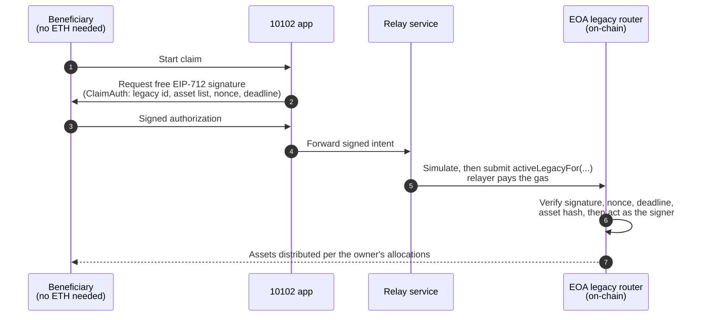

# Gas-Sponsored Intents

The hardest moment in a legacy product is the claim: the beneficiary is
often new to Ethereum, holding a freshly generated wallet with a balance of
exactly zero, and an on-chain claim costs gas. Gas-sponsored intents close
that gap: **the beneficiary signs a free message, and 10102 submits the
transaction and pays the fee.** The same mechanism lets an owner reset their
inactivity timer, or withdraw their own timelock, without paying gas.

## The one-sentence version

**You sign an EIP-712 authorization (free); any relayer (normally ours) can
submit it, but the contract only ever acts as the signer, for the signer.**

## How it works

The EOA legacy router exposes signature-authorized twins of its two
identity-bound entrypoints:

| Direct call (you pay gas) | Sponsored twin (relayer pays gas) | Who signs |
| --- | --- | --- |
| `activeLegacy` (claim) | `activeLegacyFor` | the beneficiary |
| `activeAlive` (owner check-in) | `activeAliveFor` | the owner |

Instead of proving identity with `msg.sender`, the sponsored twins recover it
from an EIP-712 signature (domain `10102 Legacy Sponsored`, bound to the
router's address and the current chain). The recovered signer is then used
exactly where `msg.sender` would have been; the relayer's own address plays
no role in what happens.

A claim authorization binds, in one signature:

- **the beneficiary** (recovered signer; funds only ever go to their own
  allocation),
- **the specific legacy** (its id),
- **the exact asset list** being claimed (hashed into the signature; the
  relayer cannot add, drop, or reorder assets),
- **a single-shot nonce** (each signer has a sequential on-chain nonce; a
  signature is consumed exactly once and can never be replayed),
- **a deadline** (expired intents are worthless; check-in signatures
  additionally cannot be dated more than one hour ahead, so a relayer cannot
  hoard one and submit it months later).

Anyone who changes their mind about an outstanding signed intent can cancel
it on-chain by advancing their nonce (`invalidateSponsorNonce`).

### Timelock withdrawals

The timelock router has the same pattern for withdrawals: `withdraw` is the
direct call, `withdrawFor` the sponsored twin. The lock's recipient signs a
`WithdrawAuth` (domain `10102 Timelock Sponsored`, version `2`) binding the
timelock id, whether to swap the stored token back to ETH, the signer's own
sequential nonce on that router, and a deadline (refused if more than 7
days after submission). The vaults pay out only when the recovered signer is
the lock's recipient. Version `2` adds `payTo`, a destination wallet the
recipient may name in the same signature; zero means the recipient itself,
and the router refuses the router or a vault as a destination.

Our relay serves three kinds of withdrawal:

- **An owner's own timelock** (a regular or soft lock the wallet created for
  itself, so owner and recipient are the same wallet). Our relay serves
  this for Premium owners only, refuses any request that names a `payTo`
  (the app never sets one for owners), and accepts a deadline of at most an
  hour. The money can only go back to the owner's wallet.
- **A gift**: its recipient claims it for free, whoever they are.
- **A Save take-back**: an email wallet taking back its own Save on
  autopilot lock (owner, recipient and signer are all that wallet, which
  holds no ETH), free without Premium. It may name another wallet as
  `payTo`.

## What a malicious relayer could do

Submit your intent, or not submit it. That is the whole list. It cannot
redirect funds (they flow to the recovered signer's own allocation, or for a
timelock to its recipient or the destination the recipient signed), cannot
alter what is claimed (the asset list is inside the signature), cannot replay
(single-shot nonce), and cannot act without a signature that you produced.
The worst case (a relayer that silently drops your intent) degrades to the
world before this feature existed: you submit the direct call yourself.
Relaying is deliberately **permissionless** for the same reason; if our
relayer disappears, anyone can run one.

## Owner control

Sponsored **claims are on by default** for every EOA transfer legacy. An
owner who does not want third parties submitting claim transactions for
their legacy can turn them off (and back on) at any time with
`setSponsoredClaimsEnabled`; the direct, beneficiary-pays claim path is
always available regardless.

## 10102's relayer

The app wires this in automatically. When a beneficiary starts a claim and
their wallet cannot cover the network fee, the app switches from "send a
transaction" to "sign an authorization", forwards it to our relay service,
and tracks the resulting transaction exactly as if the beneficiary had sent
it. Beneficiaries with ETH simply pay their own fee as before. For a Premium
owner, **Check in** and **Withdraw** on their own timelock ask for the
signature first, and the wallet sends a normal transaction if the relay
declines.

Our relay service (the reminder worker) has one route per kind of intent:

| Route | Contract call | Who it relays for |
| --- | --- | --- |
| `/sponsor/claim` | `activeLegacyFor` | every beneficiary |
| `/sponsor/checkin` | `activeAliveFor` | Premium owners |
| `/sponsor/timelock-withdraw` | `withdrawFor` | Premium owners, their own lock, no `payTo` |
| `/sponsor/gift-withdraw` | `withdrawFor` | gift recipients, and email wallets taking back their own Save lock |
| `/sponsor/shield` | Shield Vault exits and signed actions | everyone (its check-in by signature: Premium owners) |

Who gets a free relay is a policy choice in the relayer, not a protocol
rule: the contract entrypoints themselves don't distinguish. Claims are
relayed free for everyone; an owner checking in or withdrawing their own
lock is alive, able to pay, and doing something recurring, so we cover those
fees only for subscribers.

The relay applies operational bounds of its own. None is load-bearing for
safety (that all lives on-chain); they bound what we spend:

- **Separate daily budgets.** Every relay is a row in a ledger, counted over
  a rolling 24 hours. The Premium perks (owner check-ins, owner timelock
  withdrawals, Shield Vault check-ins) share their own budget of 25 a day
  across all owners, a constant in the code. Claims, gift claims, Save
  take-backs and Shield Vault exits share a second one, and email-wallet
  transfers and fee top-ups have caps of their own. None can use up
  another's, so a busy day of check-ins never switches off beneficiary
  claims. Each legacy, timelock or holding also has its own daily cap, and
  owner timelock withdrawals have a per-owner cap as well.
- **A gas-price ceiling.** When the network's fee per gas is above the
  relay's ceiling, it declines (`gas_too_high`) rather than pay a spike.
- **A gas ceiling per route.** The relay simulates every call first, so an
  intent that would revert costs nothing. The estimate must then fit the
  route's ceiling: a base of 350,000 gas, plus 80,000 per asset claimed,
  nothing more for a check-in, 150,000 more for a withdrawal that swaps the
  stored token back to ETH, 150,000 more for a Shield Vault exit and 600,000
  more for a release to up to 10 people. A token that burns gas in its
  transfer would otherwise make one relay cost a block. Above the ceiling
  the relay declines (`gas_too_costly`); below it, the transaction goes out
  with an explicit gas limit (the estimate plus a fifth and 10,000 gas,
  never above the ceiling).
- **A duplicate guard.** Two copies of one request racing would both pass
  the checks, and the second would revert at our cost. So the relay takes
  one request at a time per signer's nonce slot, and holds it until the
  transaction is mined; it reads the signer's nonce at the pending block, so
  a sent but unmined request counts (a different nonce is refused with
  `409 InvalidSponsorNonce` and the expected one); and it reserves a ledger
  row before sending, keyed on the exact signed request, including a digest
  of the signature. A second copy is answered `409 already_in_flight` while
  the first is running, or `409 already_relayed` once it was sent. A row
  whose send failed before broadcast is released. Because the key includes
  the signature, a request whose transaction was dropped can be signed
  again and relayed; only copies of the same signed request collide.
- **Screening and limits.** Requests are rate-limited per IP address.
  Timelock withdrawals screen the signer, and any `payTo`, against the
  Chainalysis sanctions oracle, and refuse when it cannot be read.

The app does its part: when a relay call times out or answers
`already_in_flight` or `already_relayed`, it reads the signer's nonce on
chain before offering a paid transaction, and waits for a copy that is on
its way. A paid fallback goes out only when the signature was never used.

## Honest limits

- **Not gasless, but gas-sponsored.** Someone still pays; for claims it's us.
  The daily caps and ceilings mean that in an extreme rush, or when fees
  spike, the relayer can decline: beneficiaries fall back to paying their own
  fee, and owners' wallets send a normal transaction.
- **Smart-contract wallets are supported** (ERC-1271 signature validation,
  including Safe), with one inherent caveat of that standard: a contract
  wallet decides validity at verification time, so rotating its owners can
  invalidate an intent that is already signed but not yet submitted.
- **This is the signed-intent generation, not account abstraction.** The
  long-term end-state for fee abstraction is EIP-7702/paymasters; this
  mechanism is compatible with that future and doesn't block it.

## Related pages

- [Legacy contracts created with EOAs](legacy-contracts-created-with-eoas.md)
- [Create flow v2](create-flow-v2.md)
- [EOA activity auto-renew](eoa-activity-auto-renew.md): the other
  "10102 pays the gas" mechanism, for automatic timer renewals
- [Upgrade Policy](upgrade-policy.md)
