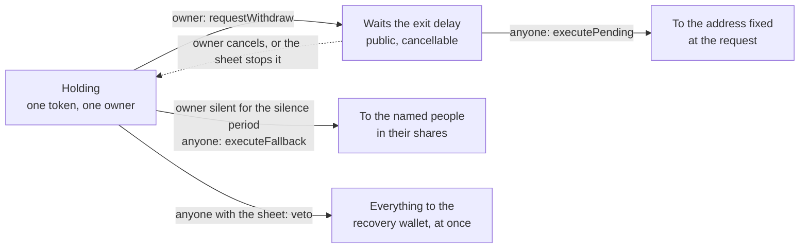

# Shield Vault

A Shield Vault holding is one token, deposited by one wallet, that can only
leave slowly and in public. This page is the contract side of
[Protect a holding](../user-guide/shield.md): what the code enforces, which
vault a holding lives in, and what nobody can do, us included.

## The one-sentence version

**Funds leave a holding in exactly three ways: the owner's own withdrawal
after the wait the owner chose, a release to the people the owner named
after a long silence, or the recovery sheet, which moves everything to a
recovery wallet fixed in advance. Nothing else, and none of the three can be
paused.**

## Two vaults on mainnet

| | Shield Vault v3 | Shield Vault v2 |
|---|---|---|
| Contract | [`0x1610DC8D25475959D5ba9395c4CE02456B51EB59`](https://etherscan.io/address/0x1610DC8D25475959D5ba9395c4CE02456B51EB59#code) (`ShieldVaultV3`) | [`0xA1EA2F8C0518458975E09ED63bf5D48980f76C38`](https://etherscan.io/address/0xA1EA2F8C0518458975E09ED63bf5D48980f76C38#code) (`ShieldVault`) |
| On mainnet since | 2026-11-11 | 2026-09-29 |
| New holdings | Yes: every new holding opens here | No: the governance Safe paused deposits on 2026-11-11 |
| Exits | Always open | Always open, for good |
| Fee | Only on a release to the named people after the owner's silence | At the rate fixed when the holding opened, on withdrawals and on releases; 0 for holdings opened since 2026-11-09 |

Neither vault is a proxy and neither can be upgraded. That is why there are
two: v3 changes when the fee is taken, and a change like that is a new
deployment, never an edit of a contract that holds funds. A holding stays in
the vault it was opened in and keeps the terms it opened with. v2 held no
holding on mainnet on the day its deposits were paused. The first vault of
all (`0x83074f8519F54AF05f7C48911E432e0C44dBEE69`, 2026-09-28) was paused
for deposits the evening it went live and never held anything on mainnet.

The two vaults have the same functions, events and signing domain, so one
ABI reads both. Holding numbers restart at 1 in v3, which is why a v3 status
page names its vault (`/shield/<chainId>/<vault>/<number>`) while the
shorter links printed or emailed before v3 (`/shield/<chainId>/<number>`)
keep opening the v2 holding.

## A holding

`open(token, amount, config, vetoIndex, maxFeeBps)` creates a holding and
stores, for that holding only:

- **The token**: one of the tokens the vault accepts (wstETH, USDC, USDT
  and WETH on mainnet).
- **The exit delay**: 7, 30 or 90 days. The contract accepts no other value.
- **The silence period and the people**, optional: 180 to 1,095 days
  without owner activity, then up to 10 addresses with shares that add up to
  100%. A share can be marked as held, for a person whose key is printed on
  a card and holds no ETH.
- **The recovery commitment**, optional: the hash on the recovery sheet
  (below).
- **The fee rate**, copied from the vault at that moment. A later change of
  the vault's rate never applies to a holding that exists. `maxFeeBps` is
  the highest rate the caller accepts: if the rate was raised between
  signing and inclusion, the open reverts instead of binding.

## The three exits



1. **The owner's withdrawal.** `requestWithdraw` names an amount and a
   destination and starts the wait; `executePending` finishes it once the
   delay has passed. The owner can cancel any time before. A change of
   settings (`requestChange`: the delay, the people, the sheet) waits the
   *current* delay in the same way, so a thief with the key cannot shorten
   the wait or swap the people first.
2. **The release after silence.** Once the silence period has passed with no
   owner activity and nothing is pending, `executeFallback` pays each named
   person their share. A share marked as held, or a transfer the token
   refuses, is recorded as owed to that person and does not block the
   others; `claimOwed` pays it later.
3. **The recovery sheet.** `veto(id, secret, recoveryWallet)` moves the
   whole balance to the recovery wallet and closes the holding, at any time
   and whatever is pending. If that transfer fails, the amount is owed to
   the recovery wallet: the stop itself never fails.

`executePending`, `executeFallback`, `veto`, `claimOwed` and `collectFees`
pay addresses that were fixed earlier, so the contract lets anyone submit
them. That is what makes a free relay possible, and what makes them
impossible to withhold.

## The recovery sheet

The sheet carries a 32-byte secret and a recovery wallet. What is on-chain
is only their hash, registered in the
[QuantumRecoveryRegistry](quantum-readiness.md#the-recovery-registry) and
pinned to the holding:

```
keccak256(abi.encode(tag, chainId, vault, owner, secret, recoveryWallet))
tag = keccak256("10102.ShieldVault.veto.v2")
```

- **The destination is inside the hash.** A copied sheet can only send the
  holding to the owner's own recovery wallet. It still ends the holding
  early, so it is kept like a key.
- **The vault and the owner are inside the hash.** A sheet made for one
  vault does not verify on the other, and a copy of the public hash pinned
  by someone else never verifies on their holding.
- **One sheet, one holding.** Revealing a secret makes it public, so the
  vault refuses to pin the same commitment to a second holding of the same
  owner.
- **It is a hash preimage, not a signature.** Stopping a withdrawal needs no
  key of the owner's, which is why it works against an attacker who holds
  that key, classical or quantum.

## The fee

**v3 takes a fee in one place only: `executeFallback`, the release to the
named people after the owner's silence.** It is the holding's own rate
(0.25% at launch, fixed when the holding opened), taken once, on the balance
released, before the split. Shares that are held or owed are recorded after
the fee, so claiming them later is never charged again.

Never charged in v3: the owner's withdrawals (the whole balance included),
cancels, changes of settings, a stop with the recovery sheet, and claims of
a kept share. An owner can therefore pass a holding to someone while alive
without a fee, by withdrawing to that person's address: that is the owner's
own money going where the owner sends it.

The governance Safe can set the rate for holdings opened later, never above
0.5% (`MAX_FEE_BPS = 50`, a constant in the code), and never for a holding
that exists. Fees accrue inside the vault and anyone can send them to the
fee recipient with `collectFees`, so a fee can never sit in the path of an
exit.

v2 charges its rate on withdrawals as well as on releases, because it
cannot tell an owner's withdrawal from a release to other people. That is
the reason v3 exists. The v2 rate for new holdings was 0.25% from launch and
0 from 2026-11-09 until its deposits were paused; a v2 holding keeps
whichever rate it opened with.

## What the owner key can and cannot do

Both vaults are owned by the governance Safe (two-step ownership), from
construction in v3. Its whole surface:

| It can | It cannot |
|---|---|
| Choose which tokens new deposits may use | Move, freeze or redirect a holding |
| Pause **new** deposits (opens and top-ups) | Pause or slow a withdrawal, a release, a stop or a claim |
| Set the fee rate for holdings opened later, at most 0.5% | Change the rate of a holding that exists |
| Choose where collected fees go | Change a holding's delay, people or recovery wallet |

There is no upgrade path. A bug fix is a new vault, and every holding can
leave the old one through its own wait.

## Signed actions and the free relay

Three actions also exist in a signed form, so they can be sent by someone
else (EIP-712, domain `10102 ShieldVault`, version `2`, bound to the vault's
address; contract wallets sign through ERC-1271):

- `checkInWithSig`: the owner's check-in.
- `cancelPendingWithSig`: the owner's cancel, bound to the holding and to
  the moment its pending operation becomes executable, so an owner whose
  wallet a thief emptied of ETH can still stop a withdrawal.
- `claimOwedWithSig`: a named person claims a kept share to a wallet they
  choose, so a key printed on a card needs no ETH.

There is deliberately no signed way to *start* a withdrawal or a change: a
phished signature must never be able to begin a theft.

Our relay sends the permissionless exits, the signed cancel and the signed
claim free for everyone, and the signed check-in for Premium owners; see
[Gas-Sponsored Intents](gas-sponsored-intents.md). If the relay declines or
is down, every one of them is an ordinary transaction from any wallet.

## What runs off-chain

All of it optional, none of it able to move a holding:

- **Alerts.** Where the owner left an email, the reminder worker writes when
  a withdrawal or a settings change starts on a holding, and again a day
  before it can complete. The wait only protects an owner who notices.
- **Terms.** The vault records no consent itself. After `open`, the app asks
  for one more transaction, `recordSelfConsent` on the terms verifier, which
  records that the wallet accepted the terms in force for that holding. The
  holding does not depend on it.
- **Indexing.** The subgraph indexes both vaults. The app reads holdings
  from the chain.

## Review status and honest limits

- **Not independently audited.** v2 had two adversarial reviews before
  deployment. v3 was reviewed internally and went live before an external
  review, which is still to be commissioned. Both vaults carry measured
  test coverage, Foundry fuzz and invariant suites, and static analysis
  (Slither); the registry carries measured test coverage and static
  analysis. See
  [Review status](README.md#review-status).
- **The wait is only as good as the watching.** A withdrawal nobody notices
  completes after the delay. Email alerts are optional and can fail.
- **The sheet is a key.** Whoever holds it can end the holding early, to the
  recovery wallet printed on it. Lose the sheet or the recovery wallet and
  that protection is gone.
- **No sheet and nobody named means no way back.** A holding with neither a
  recovery sheet nor a release to named people is locked for good if its
  key is lost. Any on-chain way out would be a way in for someone else.
- **Small accepted edges.** Signed actions use one counter per signer and
  purpose, not per holding, so check-ins signed ahead for several holdings
  void each other after the first is used (the app signs each just before
  sending). A wallet that runs contract code through EIP-7702 is treated as
  a contract wherever the vault tells the two apart.
