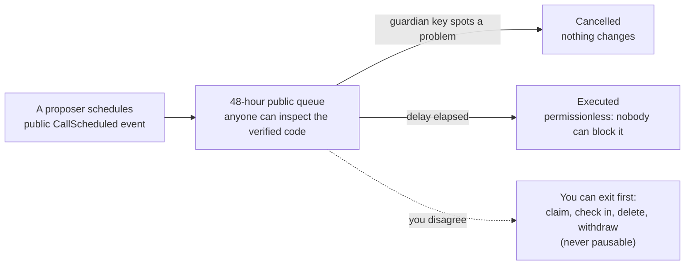

# Upgrade Policy

10102 is non-custodial: your assets stay in your wallet or in contracts only
you control. But parts of the protocol (the routers that create legacies and
timelocks, the premium stack) are upgradeable proxies, and an upgradeable
contract is only as trustworthy as its upgrade process. This page is our
standing commitment on how upgrades work, written so a stranger can verify
every claim on-chain.

Not everything is upgradeable. A legacy contract, the pull vaults, the
Shield Vaults and the recovery registry have no upgrade path at all: what
exists keeps its code, and a fix is a new deployment for new users.

## The one-sentence version

**No contract implementation can change without first sitting in a public,
on-chain queue for 48 hours; a hardware key with no proposer role of its
own can stop anything queued; and nothing that lets you exit (claim, check
in, delete, withdraw) can ever be paused.**

## How it works

Every upgradeable proxy in the protocol is administered by a single
`ProxyAdmin` contract, and that ProxyAdmin is owned by a **timelock**
([`UpgradeTimelock` on Etherscan](https://etherscan.io/address/0xc0Fee69ffAA1d62D701Bb277031CEc0d98AFA4Ad#code),
based on OpenZeppelin's audited `TimelockController`):

1. An upgrade is **scheduled** on the timelock by a **proposer**. This
   emits a public `CallScheduled` event naming the target contract and the
   new implementation.
2. It **waits at least 48 hours**. During this window anyone can inspect the
   queued implementation's verified source code, and a **canceller** can
   stop it.
3. Only then can it **execute**. Execution is permissionless: once the
   delay has passed, nobody can block a queued operation, and before it has
   passed, nobody can accelerate it.

The timelock administers itself: changing the delay or the roles is itself a
queued, delayed operation.

## Who holds which key

Since 24 September 2026 the roles are split: the key that routinely queues
changes cannot cancel, and the key that cancels cannot queue. It holds no
proposer role, and since 25 November 2026 the Safe it co-owns takes two
signatures:

| Role | Holder | Can do | Cannot do |
|---|---|---|---|
| Proposer | The governance Safe (three owners, two signatures needed), a [Safe](https://app.safe.global) at [`0x60B3da49f05E21a1fcD7e210075A23b75939C3eA`](https://etherscan.io/address/0x60B3da49f05E21a1fcD7e210075A23b75939C3eA) | Queue upgrades and role or delay changes | Execute early, cancel |
| Proposer | The maintainer key `0xfe8b…b630` | Queue routine upgrades from scripts | Execute early, cancel |
| Canceller | A hardware wallet, [`0x7B61dD775422f465D6b9f28C8EFEE39263ef2579`](https://etherscan.io/address/0x7B61dD775422f465D6b9f28C8EFEE39263ef2579), never connected to a browser extension | Stop anything queued | Queue anything: it holds no proposer role, and in the Safe it is one owner of three |
| Executor | Anyone | Execute an operation whose delay has passed | Execute early |
| Admin | The timelock itself | Grant or revoke roles, change the delay, all through the same queue | Act instantly |

**The Safe today: three owners, two signatures.** Since 2026-11-25 18:53
UTC
([transaction](https://etherscan.io/tx/0xa5ede822c7469c2ce5cc19be2d68a517792aa01f399c90b15973177b0221d812))
its owners are the guardian hardware key, the maintainer key and a third
key, and two of them must sign. Until then it had two owners and one
signature was enough, so either of them alone could do what the Safe can
do, and the guardian key could queue an operation through it. Read the
live table any time: `hasRole` on the timelock, `getOwners()` and
`getThreshold()` on the Safe, or the open-source `verify-governance`
script in the contracts repository, which prints every row above, and the
Safe's threshold and owner count, as pass or fail.

What waits in the 48-hour queue today:

- **Every implementation change.** The timelock owns the `ProxyAdmin` of
  every proxy: the legacy and timelock routers, the Premium contracts, the
  terms verifier and the timelock vaults.
- **The three timelock vaults' settings.** The vaults hold every escrowed
  timelock and gift, and the timelock owns them: which router may instruct
  them and which swap router an ETH gift uses at claim are queued
  operations too.
- **The wallet-legacy router's settings for NEW legacies**, since
  2026-11-07: which contract code a new legacy is a copy of
  (`setLegacyImplementation`), which vault its token permission names
  (`setPullVault`), and which key may renew legacies automatically (a
  non-zero `setActivityAttestor`). Before that date one admin key could
  change them at once.
- **Which implementations `LegacyPullVaultV2` accepts.** Only the timelock
  can add one, and none can ever be removed.
- **Which routers may deploy a legacy**, since 2026-11-19: the timelock
  owns `LegacyDeployer`.
- **The timelock's own roles and delay.**

What the governance Safe holds directly, without the queue:

- The wallet-legacy router's admin role since 2026-11-07, which is now
  limited to the two instant levers described below.
- The timelock router: its create pause and its creation settings
  (`setTimelock`, `setTokenWhitelist`, `setUniswapRouter`,
  `setConsentVerifier`), that is, which vault contracts, token list and
  swap router a NEW lock goes through. They take effect at once.
- Every role on the `Payment` contract since 2026-09-29: the delivery fee
  rate for new legacies and the treasury withdrawals.
- Both Shield Vaults, whose owner can only choose accepted tokens, pause
  new deposits, set the fee for holdings opened later and choose where
  collected fees go (see
  [Shield Vault](shield-vault.md#what-the-owner-key-can-and-cannot-do)).
- `PremiumSetting`, and a co-admin role on `PremiumRegistry`, `Banner`,
  the token list and the NFT list, so it can remove the maintainer key
  there if that key ever leaked.

Held by the maintainer key alone, with no Safe role and no queue: the
owner role of the terms verifier (the terms version and hash new consents
are recorded against, and which routers may record a consent). It cannot
touch a legacy, a lock or a holding that exists; a wrong setting there
would make NEW creates fail until it is corrected.

## What we will and won't upgrade

- **We will** ship upgrades for security fixes, gas savings, and new
  features, announced in the changelog when they are queued, not after they
  land.
- **We won't** upgrade in ways that move or restrict user assets: claims,
  check-ins, deletions and withdrawals are permanent capabilities. They are
  not pausable today, and no upgrade weakening them will be queued.
- **Existing legacy contracts never hot-swap.** Each legacy clone pins its
  implementation and its Permit2 vault at creation time. Upgrades affect
  how NEW contracts are created; your existing contract keeps the exact
  code you audited (or your beneficiary's claim card references) forever.
  When legacy v3 became the code of new wallet legacies on 2026-11-13,
  every legacy created before kept its own: an owner who wants v3 creates
  a new legacy.
- **A queued operation that will not run is cancelled the same day.** A
  ready operation never expires and anyone may execute it, so nothing we
  decided against is left in the queue.

## What is deliberately NOT timelocked

Honesty over theater. These admin actions work instantly, all from the
governance Safe unless noted. None of them can move, freeze or re-price a
legacy, a lock or a holding that exists:

- **Pausing new creates.** We can halt NEW wallet-legacy creation, and
  separately NEW timelock creation, at once. Exit paths are unaffected:
  a pause can keep new users out of a problem, never trap existing ones.
- **Stopping automatic renewals.** If the key that renews legacies for
  active owners misbehaves, the Safe can switch renewals off at once.
  Turning them back on, with a new key, goes through the 48-hour queue.
  Owners can always check in themselves.
- **Pausing new Shield Vault deposits.** New holdings and top-ups only;
  every exit of every holding keeps working. This is how deposits into the
  earlier vault were closed on 2026-11-11.
- **Fee rates for what is created next.** The delivery fee a NEW legacy
  copies at creation, and the fee for Shield Vault holdings opened later.
  The contracts cap both at 0.5%, and neither can change for a legacy or a
  holding that exists.
- **The timelock router's creation settings, and the treasury.** Which
  vault contracts, token list and swap router a NEW lock, gift or Save
  deposit goes through, and withdrawing the fees collected in `Payment`.
  What a hostile use of them could do is stated under
  [The honest limit](#the-honest-limit).
- **Operational settings**: the token and NFT collection lists, Premium
  plans, coupons and referrer shares, and which terms version new consents
  are recorded against. Most are set by the maintainer key day to day.
  These cannot touch existing contracts or user balances. (Removing an NFT
  collection from its list stops new naming only; an item already named
  stays claimable until its owner saves the NFT list again or changes the
  first-line beneficiaries or shares, either of which drops it for good.)

Three levels, to keep them apart:

- **No key can do it instantly**: pause a claim, a check-in, a delete or a
  withdrawal (no such function exists anywhere), or change the fee of a
  legacy or a holding that exists.
- **Only the 48-hour queue could do it**: change the code a router or a
  timelock vault runs, which includes how the router instructs existing legacies
  and how the vaults release locked funds. That is the reason the queue is
  public and a separate key watches it.
- **Nothing can do it**: change the code of a legacy contract, a pull vault
  or a Shield Vault. They have no upgrade path.

## The honest limit

For upgrades the timelock is a transparency window with a brake, not
multi-party control. The maintainer key can still queue an upgrade on its
own. What it cannot do is cancel, and what it never could do is skip the
queue. We decided on 2026-11-25 to keep it that way for now: routine
upgrades are queued from scripts with that key, more of them are likely in
the coming months, and what stands between a queued change and the
contracts is the public 48-hour wait and a separate key that can cancel.
The guardian key can cancel, and since the Safe takes two signatures it
can queue nothing alone.

What the Safe can do without the queue takes two of its three keys since
2026-11-25, changing the Safe's own owners and threshold included. None of
it can move, freeze or re-price a legacy, a lock or a holding that exists.
Pausing new creates or deposits, or stopping renewals, is an annoyance.
Two powers are more than that. The timelock
router's creation settings decide which vault contracts and which swap
router a NEW lock, gift or Save deposit goes through, so a hostile change
could misdirect what someone locks after it; the router's own withdraw
functions would also stop finding existing locks until it is set back,
while each vault's `withdraw` keeps paying the lock's recipient, whoever
calls it. And the `Payment` roles can withdraw the fees collected.

A malicious or mistaken queued operation cannot land silently: our
monitoring alerts on every `CallScheduled`, the guardian key has 48 hours
to cancel, and you have 48 hours to exit if you disagree with any queued
change. This page used to name three steps to come. The first is done: the
Safe takes two of three signatures since 2026-11-25. The other two, the
maintainer key giving up its proposer role and the delay rising from 48
hours to 7 days, are not planned for now. If that changes, either one is
a queued operation like any other, visible 48 hours before it takes
effect, and this page will say so.

That monitoring runs in one place, our own worker, and alerts by email. An
independent second watcher is not in place yet, which is one more reason to
[watch the queue yourself](#watch-the-queue-yourself).

## What was reviewed, and by whom

The upgrade process protects you from a silent change. It says nothing
about whether the code is right, so here is the other half, stated exactly:

- The contracts were audited twice (reports of January 2025 and October
  2025): by RockSolid Security (the legacy suite) and by CDSecurity (the
  full suite, including the timelocks and Premium).
- No published audit report covers anything deployed since October 2025.
  That includes every clone implementation wallet legacies have used
  (clones began in May 2026) and the one-transaction create of 2026-07-27
  (Permit2 permissions, signed gas-free claims, check-ins and timelock
  withdrawals, consent in the transaction, the create pauses). Internal
  adversarial review is on record for: `LegacyPullVault`, automatic
  renewal, `QuantumRecoveryRegistry`, `UpgradeTimelock` (a thin subclass
  of OpenZeppelin's audited `TimelockController`), `ShieldVault`, the
  destination wallet on timelock claims (2026-09-24), the upgrade of
  2026-11-07 (`LegacyPullVaultV2`, the clone new legacies used until
  2026-11-13, the router settings that now wait in the timelock, and the
  coupon codes and referrer shares in `PremiumRegistry`), the router
  change of 2026-11-18 (only the claim that ends a legacy releases the
  owner's create flag), and the Safe legacy change of 2026-11-21 (a guard
  whose clock only the Safe moves, and a router that activates a legacy
  only while it is connected to its Safe).
- Legacy v3 (mainnet since 2026-11-13 20:42 UTC) and Shield Vault v3
  (mainnet since 2026-11-11) went live before an external review, which is
  still to be commissioned.

The longer version, with the tooling evidence and the compiler assessment,
is in [Architecture, Review status](README.md#review-status).

## Watch the queue yourself

- Timelock contract (mainnet):
  [`0xc0Fee69ffAA1d62D701Bb277031CEc0d98AFA4Ad`](https://etherscan.io/address/0xc0Fee69ffAA1d62D701Bb277031CEc0d98AFA4Ad).
  Watch the `CallScheduled`, `CallExecuted` and `Cancelled` events (the
  Events tab on Etherscan, or an address watch/alert service pointed at the
  contract).
- ProxyAdmin (owned by the timelock):
  [`0xA41299408EB78D67B9b599e38E3259C11A005145`](https://etherscan.io/address/0xA41299408EB78D67B9b599e38E3259C11A005145).
  Its `owner()` is the timelock; verify it yourself.
- Roles: call `hasRole(role, account)` on the timelock with
  `PROPOSER_ROLE`, `CANCELLER_ROLE` or `EXECUTOR_ROLE`
  (`keccak256` of those strings) and the addresses in the table above.
- What new wallet legacies get: on the router
  ([`0x4E81E1Ed3F6684EB948F8956b8787967b1a6275b`](https://etherscan.io/address/0x4E81E1Ed3F6684EB948F8956b8787967b1a6275b#readProxyContract)),
  `legacyImplementation()` is today
  `0xF9B6241Ab7513181C9Ed4F0920E0B008fB9264e9` (legacy v3) and
  `pullVault()` is `0xC6640962618f9D729032487EC5DEf226BF6F43E3`
  (`LegacyPullVaultV2`). `upgradeTimelock()` names the only address that
  can change them, `createPaused()` says whether new creates are paused,
  and `activityAttestor()` is the key that may renew (zero when renewals
  are stopped).
- Every implementation we queue is verified on Etherscan before scheduling,
  so the diff is inspectable during the full waiting period.
- Changelog entries are written when an operation is queued, with its
  operation id and the time it becomes executable, not after it lands.
